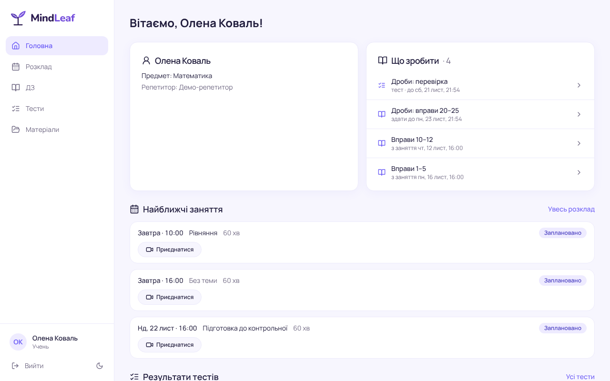

# MindLeaf

**An online cabinet for a private tutor, their students and the parents: schedule, student and payment tracking, homework, quizzes and reminders in one place.**

🌐 **Live demo:** https://mindleaf-web.onrender.com — sign up with email or Google, free.


*The interface is in Ukrainian: the product is built for tutors in Ukraine.*

## Why

A private tutor with 5–30 students usually runs their work across messengers, Google Calendar, spreadsheets and a notebook: the schedule is in one place, who paid what is in another, homework arrives as photos in Telegram and gets lost, and parents keep asking how their child is doing and how much they owe. MindLeaf brings this into one cabinet where everyone sees their own part:

| Who | What they do in MindLeaf |
| --- | --- |
| **Tutor** (pays for the plan) | Keeps a list of students, plans lessons in a weekly calendar, marks lessons as done and records payments — balances and debts are calculated automatically. Assigns homework with deadlines and quizzes (written by hand or drafted from a material), shares materials. |
| **Student** (free) | Sees the schedule and a "Join" button for the online lesson, hands in homework as text or photos, takes quizzes with instant results, opens materials. |
| **Parent** (free) | Sees the child's schedule, homework and results, the balance and payment history; can cancel a lesson in advance (the tutor sets how far ahead). |

Students and parents join with a one-time code that the tutor issues on the student's card.

## Features

- **Sign-in** with email + password or Google (Amazon Cognito); name and role on the first sign-in.
- **Schedule:** weekly calendar and list view; lessons with a topic, price, homework and a Zoom/Meet link (a permanent one per student or a separate one per lesson).
- **Tracking:** student balance = payments − lessons held; debts are shown on the tutor's dashboard and to parents.
- **Learning:** homework with deadlines and a 1–12 grade, quizzes with auto-graded multiple choice, materials (PDF, photos, notes).
- **Telegram reminders:** ~1 hour before a lesson (with the link to join right away) and a day before a homework or quiz deadline if it is not handed in yet. Connected with one "Reminders" button.
- **Plans:** Free — up to 3 students; Pro — 199 UAH/month or 1990 UAH/year via LiqPay; promo codes.
- Ukrainian UI, hryvnias, `Europe/Kyiv` time; works on phones; light and dark theme.

<table>
  <tr>
    <td></td>
    <td></td>
  </tr>
  <tr>
    <td align="center">Tutor's schedule</td>
    <td align="center">Student's home page</td>
  </tr>
  <tr>
    <td></td>
    <td></td>
  </tr>
  <tr>
    <td align="center">Payments in the parent's cabinet</td>
    <td align="center">Sign-in</td>
  </tr>
</table>

## Try it

**Online** (nothing to install):

1. Open https://mindleaf-web.onrender.com → **Увійти через Google** (Google) or **Увійти через email** (email) → enter your name → **Створити кабінет репетитора** (create a tutor cabinet).
2. **Учні → Додати учня** (Students → Add student), then on the student's card press **Код для учня** or **Код для батьків** (code for the student / for a parent; one-time, valid for 7 days).
3. In a private window, sign up with another account and enter that code — the student's or the parent's cabinet opens.

The server runs on Render's free plan: if nobody has used the site for a while, the first load may take up to a minute.

**Locally with demo data** (requires Docker and Node.js 20):

```sh
docker compose up --build -d          # PostgreSQL + API on http://localhost:8000
make seed                             # demo tutor, 3 students, lessons, payments, homework, quizzes
cd frontend && npm ci && npm run dev  # site on http://localhost:5173
```

The sign-in page then shows three buttons — **Репетитор** (tutor), **Учень** (student), **Батьки** (parent): they sign in to demo accounts without registration (local only). API docs: http://localhost:8000/docs.

## Repository structure

| Folder | Contents |
| --- | --- |
| [`backend/`](backend) | API: Python 3.12, FastAPI, SQLAlchemy, PostgreSQL 16, Alembic migrations, 280+ pytest tests |
| [`frontend/`](frontend) | Web app: React 18, TypeScript, Vite, Tailwind; tutor, student and parent cabinets |
| [`infra/`](infra) | Deployment: [`render.yaml`](infra/render.yaml) (the whole Render setup in one file) and a [step-by-step guide](infra/README.md) |
| [`docs/`](docs) | Architecture decision records (ADR) and screenshots |
| [`.github/workflows/`](.github/workflows) | CI (lint and tests on every push) and the Telegram reminder schedule |
| [`PROJECT.md`](PROJECT.md) | Detailed developer notes: data model, API, authentication, environment variables |

## Deploy

The prototype runs on **Render** (backend in Docker, PostgreSQL, static site — all over HTTPS); sign-in goes through **Amazon Cognito**. Once set up, every `git push` to `main` rebuilds the site, and the backend applies new migrations on start.

1. **Render:** New → Blueprint → this repository, path `infra/render.yaml` → Apply. This creates the database, the API (`mindleaf-api`) and the site (`mindleaf-web`).
2. **Cognito:** a user pool with email sign-in and self sign-up; callback and sign-out URLs point to the site.
3. **Render → Environment:** put the Cognito IDs into both services → Save, rebuild, and deploy.
4. *Optional:* Google sign-in (OAuth client in Google Cloud + identity provider in Cognito), a Telegram bot for reminders, LiqPay keys.

Every step with the exact field values is in [**infra/README.md**](infra/README.md).

## For developers

All commands run inside the backend Docker image, no local Python needed.

| Command | What it does |
| --- | --- |
| `make test` | `pytest` against PostgreSQL from compose (a separate test database) |
| `make lint` | `ruff` (backend) + ESLint and Prettier (frontend) |
| `make seed` | Demo data; running it again only resets the demo tutor |
| `make seed TUTOR_SUB=<sub>` | The same demo data for your own Cognito account |
| `docker compose down -v` | Start over with an empty database |

How the backend, data model, roles and data isolation work, every endpoint and environment variable — see [PROJECT.md](PROJECT.md); why it is built this way — see [docs/adr/](docs/adr) (both in Ukrainian).

## Prototype limitations

- Render free plan: the server sleeps without requests (the reminder schedule keeps it awake), the database lasts 30 days, homework photos are stored on the server's disk and disappear after a restart.
- AI grading and quiz generation run every 5 minutes in GitHub Actions, so results arrive with a delay of a few minutes, not instantly.
- Paying for Pro runs in demo mode without a real charge until LiqPay keys are set; Pro can also be unlocked with a promo code.
- Signing in with Google and with email using the same address currently creates two separate accounts.

Team: Kateryna Karalyus, Olha Varanytsa, Yuliia Dovhai.
