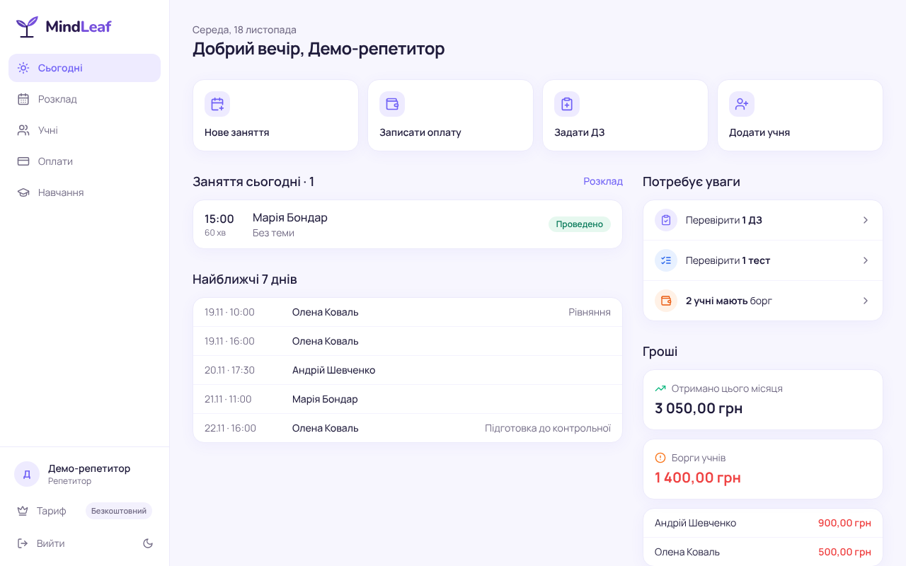
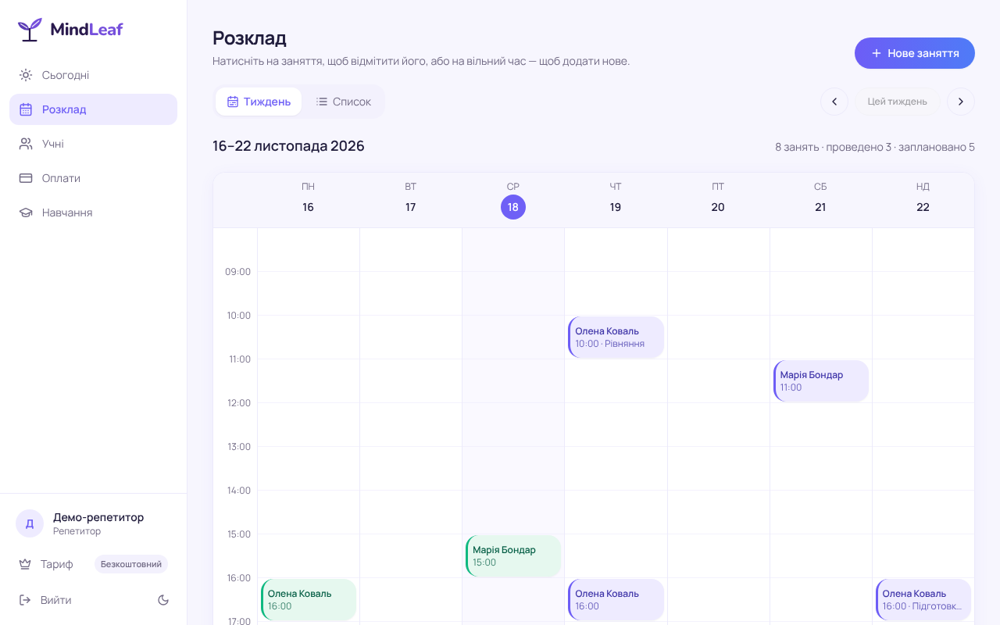
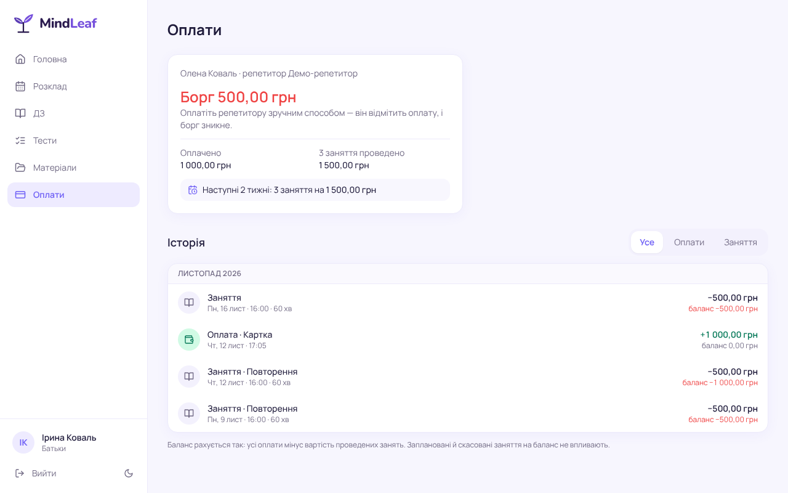
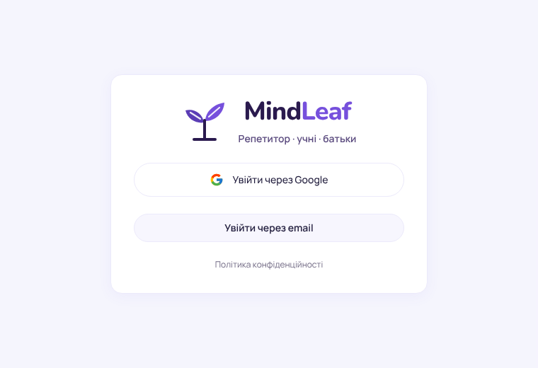

# MindLeaf

**Онлайн-кабінет для приватного репетитора, його учнів і батьків: розклад, облік учнів і оплат, домашні завдання, тести й нагадування в одному місці.**

🌐 **Робоча версія:** https://mindleaf-web.onrender.com — реєстрація через email або Google, безкоштовно.



## Навіщо

Приватний репетитор з 5–30 учнями зазвичай веде роботу в месенджерах, Google Calendar, таблицях і зошиті: розклад в одному місці, хто скільки заплатив — в іншому, ДЗ приходять фото в Telegram і губляться, а батьки щоразу питають, як справи в дитини і скільки вони винні. MindLeaf збирає це в один кабінет, де кожен бачить своє:

| Хто | Що робить у MindLeaf |
| --- | --- |
| **Репетитор** (платить за тариф) | Веде учнів, планує заняття в тижневому календарі, відмічає проведені й записує оплати — баланс і борги рахуються самі. Задає ДЗ з дедлайнами, тести (вручну або чернетку з матеріалу), ділиться матеріалами. |
| **Учень** (безкоштовно) | Бачить розклад і кнопку «Приєднатися» до онлайн-заняття, здає ДЗ текстом або фото, проходить тести з миттєвим результатом, відкриває матеріали. |
| **Батьки** (безкоштовно) | Бачать розклад, ДЗ і результати дитини, баланс і історію оплат; можуть скасувати заняття заздалегідь (строк задає репетитор). |

Учень і батьки приєднуються за одноразовим кодом, який репетитор видає в картці учня.

## Що вміє

- **Вхід** через email + пароль або Google (Amazon Cognito); при першому вході — ім'я і роль.
- **Розклад:** тижневий календар і список; заняття з темою, ціною, ДЗ і посиланням на Zoom/Meet (постійне для учня або своє для заняття).
- **Облік:** баланс учня = оплати − проведені заняття; борги видно на головній репетитора й у батьків.
- **Навчання:** ДЗ з дедлайнами й оцінкою 1–12, тести з автоперевіркою варіантів, матеріали (PDF, фото, конспекти).
- **Нагадування в Telegram:** за ~годину до заняття (з посиланням, щоб одразу приєднатися) і за добу до дедлайну ДЗ чи тесту, якщо його ще не здано. Підключається однією кнопкою «Нагадування».
- **Тариф:** Free — до 3 учнів; Pro — 199 грн/міс або 1990 грн/рік через LiqPay; промокоди.
- Українською, гривні, час `Europe/Kyiv`; працює на телефоні; світла й темна тема.

<table>
  <tr>
    <td></td>
    <td></td>
  </tr>
  <tr>
    <td align="center">Розклад репетитора</td>
    <td align="center">Головна учня</td>
  </tr>
  <tr>
    <td></td>
    <td></td>
  </tr>
  <tr>
    <td align="center">Оплати в кабінеті батьків</td>
    <td align="center">Вхід</td>
  </tr>
</table>

## Як спробувати

**На сайті** (нічого не треба встановлювати):

1. Відкрийте https://mindleaf-web.onrender.com → **Увійти через Google** або **Увійти через email** → вкажіть ім'я → **Створити кабінет репетитора**.
2. **Учні → Додати учня**, потім у картці учня натисніть **Код для учня** або **Код для батьків** (код одноразовий, діє 7 днів).
3. У вікні інкогніто зареєструйтеся ще одним акаунтом і введіть цей код — відкриється кабінет учня чи батьків.

Сервер на безкоштовному плані Render: якщо сайтом давно ніхто не користувався, перше відкриття може тривати до хвилини.

**Локально з демо-даними** (потрібні Docker і Node.js 20):

```sh
docker compose up --build -d          # PostgreSQL + API на http://localhost:8000
make seed                             # демо-репетитор, 3 учні, заняття, оплати, ДЗ, тести
cd frontend && npm ci && npm run dev  # сайт на http://localhost:5173
```

На сторінці входу з'являться три кнопки — **Репетитор**, **Учень**, **Батьки**: вони входять у демо-акаунти без реєстрації (лише локально). API-документація: http://localhost:8000/docs.

## Структура репозиторію

| Папка | Що там |
| --- | --- |
| [`backend/`](backend) | API: Python 3.12, FastAPI, SQLAlchemy, PostgreSQL 16, міграції Alembic, 280+ тестів pytest |
| [`frontend/`](frontend) | Сайт: React 18, TypeScript, Vite, Tailwind; кабінети репетитора, учня й батьків |
| [`infra/`](infra) | Деплой: [`render.yaml`](infra/render.yaml) (уся інфраструктура Render одним файлом) і [покрокова інструкція](infra/README.md) |
| [`docs/`](docs) | Архітектурні рішення (ADR) і скріншоти |
| [`.github/workflows/`](.github/workflows) | CI (лінтер і тести на кожен push) і розклад Telegram-нагадувань |
| [`PROJECT.md`](PROJECT.md) | Детальний опис для розробників: модель даних, API, автентифікація, змінні середовища |

## Як задеплоїти

Прототип працює на **Render** (backend у Docker, PostgreSQL, статичний сайт — усе з HTTPS), вхід — через **Amazon Cognito**. Після налаштування кожен `git push` у `main` перезбирає сайт сам, а backend при старті накочує нові міграції.

1. **Render:** New → Blueprint → цей репозиторій, шлях `infra/render.yaml` → Apply. Створяться база, API (`mindleaf-api`) і сайт (`mindleaf-web`).
2. **Cognito:** user pool з входом через email і self sign-up; callback і sign-out URL — адреса сайту.
3. **Render → Environment:** вписати ідентифікатори Cognito в обидва сервіси → Save, rebuild, and deploy.
4. *За бажанням:* вхід через Google (OAuth-клієнт у Google Cloud + провайдер у Cognito), Telegram-бот для нагадувань, ключі LiqPay.

Усі кроки з точними значеннями полів — у [**infra/README.md**](infra/README.md).

## Для розробників

Усі команди виконуються в Docker-образі backend, локальний Python не потрібен.

| Команда | Що робить |
| --- | --- |
| `make test` | `pytest` проти PostgreSQL з compose (окрема тестова база) |
| `make lint` | `ruff` (backend) + ESLint і Prettier (frontend) |
| `make seed` | Демо-дані; повторний запуск оновлює лише демо-репетитора |
| `make seed TUTOR_SUB=<sub>` | Ті самі демо-дані для вашого Cognito-акаунта |
| `docker compose down -v` | Почати з чистої бази |

Як влаштовані backend, модель даних, ролі й ізоляція даних, усі ендпоінти й змінні середовища — у [PROJECT.md](PROJECT.md); чому зроблено саме так — у [docs/adr/](docs/adr).

## Обмеження прототипу

- Безкоштовний план Render: сервер засинає без запитів (його будить розклад нагадувань), база діє 30 днів, фото ДЗ зберігаються на диску сервера й зникають після перезапуску.
- ШІ-генерація й перевірка тестів (Claude Haiku на Amazon Bedrock) реалізована, але на публічному сайті вимкнена — письмові відповіді оцінює репетитор.
- Оплата Pro працює в демо-режимі без справжнього списання, доки не задано ключі LiqPay; Pro можна отримати промокодом.
- Вхід через Google і через email з тією самою поштою — поки що два різні акаунти.

Команда: Kateryna Karalyus, Olha Varanytsa, Yuliia Dovhai.
